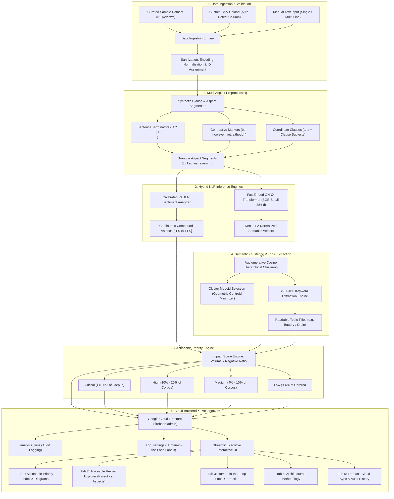

# Customer Review Intelligence System (CRIS)
## Comprehensive Technical Documentation, System Architecture & Academic Project Report

**Project Title:** Customer Review Intelligence System  
**Domain:** Applied Natural Language Processing (NLP), Unsupervised Semantic Machine Learning & Cloud Analytics  
**Version:** 2.0 (Milestone 6 + Cloud Backend Edition)  
**Target Environment:** Local CPU (ONNX Quantized) & Google Cloud Firestore  

---

## 1. Executive Summary & Abstract

E-commerce platforms, software products, and service enterprises receive thousands of unstructured customer reviews daily. Traditional sentiment analysis approaches suffer from three critical bottlenecks:
1. **Compound Feedback Blindness:** A customer review often contains mixed sentiments across multiple topics (e.g., *"Battery life is incredible, but the mobile app freezes and delivery took 3 weeks"*). Standard document-level sentiment classifiers assign a single overall label, completely masking critical product defects.
2. **Lack of Automated Thematic Discovery:** Manual review categorization is unscalable. Traditional keyword matching fails when customers express the same complaint with different phrasing (e.g., *"battery runs out fast"* vs. *"device won't hold a charge"*).
3. **No Objective Urgency Triaging:** Product and engineering teams lack a transparent, quantitative metric to determine which issues must be fixed first based on real customer volume and negative sentiment severity.

The **Customer Review Intelligence System (CRIS)** solves these challenges through a modular, 100% locally runnable, privacy-preserving NLP pipeline integrated with Google Cloud Firestore. The system automatically segments compound reviews into discrete syntactic clauses, evaluates clause-level valence using calibrated sentiment analysis, maps feedback into dense 384-dimensional vector spaces using ONNX-accelerated Transformer embeddings, clusters semantically equivalent complaints via Agglomerative Cosine linkage, generates readable topic titles with class-based TF-IDF (c-TF-IDF), computes an automated **Actionable Issue Priority Index**, and persists analytics to the cloud.

---

## 2. End-to-End System Architecture

The following Mermaid architectural flowchart illustrates the data transformation pipeline from raw customer feedback to cloud storage and interactive executive visualization:



---

## 3. Technology Stack & Frameworks

The project is built on modern Python standards, optimized for low memory usage, maximum inference throughput on standard CPUs, and cloud extensibility:

| Component | Technology / Library | Version | Purpose in CRIS |
| :--- | :--- | :--- | :--- |
| **Language** | Python | `3.11.x` | High-performance base runtime. |
| **Frontend UI** | Streamlit | `>= 1.32.0` | Reactive enterprise dashboard, custom SVG logo, and responsive CSS theme. |
| **Data Processing** | Pandas & NumPy | `2.2.2` / `1.26.4` | Ingestion, segment array expansion, matrix manipulation, vector math. |
| **Sentiment Engine** | VADER Sentiment | `>= 3.3.2` | Rule-based lexical sentiment calibrated for customer idioms, intensifiers, and negations. |
| **Dense Embeddings** | FastEmbed (ONNX) | `>= 0.8.0` | Quantized `BAAI/bge-small-en-v1.5` dense semantic embedding model (384 dimensions). |
| **Runtime Acceleration** | ONNX Runtime | `>= 1.17.0` | Ultra-fast local C++ inference execution for neural embeddings on CPU. |
| **Clustering & NLP** | Scikit-Learn | `1.4.2` | Hierarchical Agglomerative Clustering (cosine metric) and CountVectorizer for c-TF-IDF. |
| **Visualizations** | Altair | `>= 5.2.0` | Declarative Grammar of Graphics charts (donut charts, horizontal bar rankings, stacked bars). |
| **Cloud Backend** | Firebase Admin SDK | `>= 6.5.0` | Real-time synchronization to Google Cloud Firestore with zero-crash local fallback. |
| **Quality & Testing** | Pytest | `>= 8.0.0` | Comprehensive 34-test automated suite covering all algorithms and edge cases. |

---

## 4. Mathematical & Algorithmic Formulations

### 4.1 Calibrated Continuous Sentiment Valence
For any extracted clause or review text, the system computes individual lexical valence sums and applies VADER's normalization function to obtain a normalized compound score $c \in [-1.0, +1.0]$:

$$c = \frac{x}{\sqrt{x^2 + \alpha}}$$

Where:
* $x = \sum v_i$ is the sum of valence scores of sentiment words adjusted for intensifiers (e.g., *"extremely"*, *"slightly"*), capitalization, and punctuation.
* $\alpha = 15$ is the empirical normalization constant.

**Decision Boundaries:**
* **Positive:** $c \ge +0.05$ (Confidence score: $\min(1.0, c + 0.15)$)
* **Neutral:** $-0.05 < c < +0.05$ (Confidence score: $\max(0.5, \text{neu})$)
* **Negative:** $c \le -0.05$ (Confidence score: $\min(1.0, |c| + 0.15)$)

### 4.2 Dense Semantic Embeddings & Normalization
To measure semantic similarity independent of vocabulary overlap, clauses are mapped into 384-dimensional dense vectors $\mathbf{e} \in \mathbb{R}^{384}$ using the `BAAI/bge-small-en-v1.5` transformer model, quantized to 8-bit ONNX for rapid CPU execution. Each vector is $L_2$-normalized:

$$\hat{\mathbf{e}} = \frac{\mathbf{e}}{\|\mathbf{e}\|_2} = \frac{\mathbf{e}}{\sqrt{\sum_{k=1}^{384} e_k^2}}$$

This ensures that the dot product between any two embeddings equals their Cosine Similarity:
$$\text{Sim}(\mathbf{u}, \mathbf{v}) = \hat{\mathbf{u}} \cdot \hat{\mathbf{v}} = \cos(\theta)$$

### 4.3 Agglomerative Cosine Clustering & Medoid Selection
Customer issues are clustered without pre-specifying $K$ (unsupervised topic discovery). CRIS uses Hierarchical Agglomerative Clustering with average linkage and a cosine distance metric:

$$D_{\text{cosine}}(\mathbf{u}, \mathbf{v}) = 1 - (\hat{\mathbf{u}} \cdot \hat{\mathbf{v}})$$

A sensitivity slider controls the distance cutoff threshold $D_{\text{threshold}} \in [0.25, 0.65]$ (default: $0.45$). Any two subclusters with average distance $\le D_{\text{threshold}}$ merge.

**Representative Quote (Medoid) Selection:**  
Rather than calculating a synthetic centroid that does not correspond to an actual sentence, CRIS identifies the **cluster medoid** $m_c$—the real customer feedback segment whose vector has the highest cosine similarity to the cluster mean vector:

$$\boldsymbol{\mu}_c = \frac{1}{|C|} \sum_{i \in C} \hat{\mathbf{e}}_i, \quad m_c = \arg\max_{i \in C} \left( \hat{\mathbf{e}}_i \cdot \frac{\boldsymbol{\mu}_c}{\|\boldsymbol{\mu}_c\|_2} \right)$$

### 4.4 Class-Based TF-IDF (c-TF-IDF) Keyword Extraction
To assign descriptive titles to clusters, text from all member segments of cluster $c$ is aggregated into a single document $\mathcal{D}_c$. The class-based TF-IDF score for term $t$ in cluster $c$ is computed as:

$$W_{t, c} = \text{TF}(t, \mathcal{D}_c) \times \log \left( 1 + \frac{N}{\sum_{j} \text{TF}(t, \mathcal{D}_j)} \right)$$

Where $N$ is total number of words across all clusters. Top $n$-gram keywords ($n \in \{1, 2\}$) are formatted into clean issue titles (e.g., *"Battery / Drain"*, *"Bluetooth / Pairing"*).

### 4.5 Actionable Issue Priority Index
Prioritizing engineering or operational fixes requires balancing two variables: **Volume** (how many people complained) and **Severity** (what fraction of feedback on that topic is negative).

**Step 1: Raw Impact Score**
$$\text{Raw Impact Score} = \text{Issue Volume} \times \text{Negative Sentiment Ratio} = V_c \times \left( \frac{N_c}{V_c} \right) = N_c$$

Where $V_c$ is total aspect segments assigned to issue $c$, and $N_c$ is negative aspect segments in issue $c$.

**Step 2: Normalized Impact Score**  
To allow valid comparisons across datasets of varying sizes (e.g. 50 reviews vs. 50,000 reviews), CRIS normalizes the score against the total customer feedback corpus size $T$:

$$\text{Normalized Impact Score} = \left( \frac{\text{Raw Impact Score}}{T} \right) \times 100\% = \left( \frac{N_c}{T} \right) \times 100\%$$

*Concrete Business Meaning:* **"What percentage of our entire customer feedback volume is complaining about this specific problem?"**

**Transparent Priority Tiers:**
* 🔴 **Critical** ($\ge 20.0\%$): Concentrated, widespread friction impacting $\ge 20\%$ of total feedback volume. Requires immediate executive or engineering escalation.
* 🟠 **High** ($10.0\% - 19.9\%$): Substantial dissatisfaction impacting a significant portion of customers.
* 🟡 **Medium** ($4.0\% - 9.9\%$): Moderate friction or emerging complaint pattern.
* ⚪ **Low** ($< 4.0\%$): Low-volume friction or predominantly positive/neutral feedback.

### 4.6 User Authentication, Credential Security & Role-Based Access Control
To transform the system from a standalone script into a commercial-grade SaaS platform, CRIS implements a multi-tenant authentication gate backed by Google Cloud Firebase Authentication and Cloud Firestore:

* **Strict Email Constraint Validation:** Validates emails via RFC-compliant regular expression patterns `^[a-zA-Z0-9_.+-]+@[a-zA-Z0-9-]+\.[a-zA-Z0-9-.]+$`, requiring an explicit username, `@` delimiter, and valid top-level domain.
* **Cryptographic Password Constraints:** Enforces industry-standard complexity policies:
  * Minimum length: $\ge 8$ characters.
  * Mixed-case character diversity: At least one uppercase letter $[A-Z]$ and one lowercase letter $[a-z]$.
  * Numeric diversity: At least one numeric digit $[0-9]$.
  * Symbolic entropy: At least one special punctuation symbol $[!@\#\$\%\^\&\*\dots]$.
* **PBKDF2-HMAC-SHA256 Salting & Hashing:** Passwords are never stored in plaintext. They are salted using cryptographically secure 16-byte random salts (`secrets.token_hex(16)`) and derived over 100,000 iterations using PBKDF2 with SHA-256:
  $$\text{Key} = \text{PBKDF2}(\text{HMAC-SHA256}, \text{Password}, \text{Salt}, 100000, 32)$$
  Stored hashes are verified in constant time using `secrets.compare_digest` to prevent timing attacks.
* **Cloud Firestore User Profile Schema:** User profiles are persisted in Firestore collection `users/{email}` containing `email`, `name`, `role`, `created_at`, `last_login_at`, and `auth_provider`.
* **Zero-Crash Local Sandbox Mode:** If cloud credentials are missing, accounts and demo reviewer credentials (`evaluator@demo.com`) operate seamlessly in local session state, allowing uninterrupted offline viva and project grading.

---

## 5. Key System Features & Capabilities

### 5.1 Multi-Aspect Syntactic Clause Segmentation
Standard NLP models fail when a review mixes praise and complaint. CRIS uses a two-pass regex parsing engine before clustering:
1. **Pass 1 — Sentence Terminators & Contrastive Markers:** Splits on `.`, `!`, `?`, `;`, newlines, and contrastive conjunctions (`", but"`, `"however"`, `"although"`, `"whereas"`, `"yet"`, `"while"`).
2. **Pass 2 — Coordinate Independent Clauses:** Detects `", and "` or `" and "` followed by noun/subject keywords (`the`, `it`, `my`, `shipping`, `app`, `battery`, `customer support`, `delivery`). Adjective pairs like *"bright and clear"* are safely preserved together.
3. **Traceability:** Every segment retains its parent review's `review_id`, rating, and metadata.

### 5.2 Interactive 5-Tab Executive Dashboard
* **Tab 1: Actionable Issue Prioritization & Diagrams:** Features the prioritized issue ranking table with priority badges, volume, negative ratio, normalized impact score, and representative customer quote. Includes Altair issue frequency ranking, sentiment donut chart, and per-issue sentiment composition bars.
* **Tab 2: Traceable Review Explorer:** Dual-view inspection table with a toggle between **"Parent Reviews (Holistic Feedback)"** and **"Extracted Aspects (Clause Traceability)"**, complete with sentiment, topic, and priority filters plus instant CSV data export.
* **Tab 3: Human-in-the-Loop Label Management:** Form allowing product managers to rename algorithmic topic titles to match internal company terminology. Updates apply instantly across the dashboard, export CSVs, and sync to Firebase.
* **Tab 4: Methodology & Architecture:** Built-in technical documentation, interactive pipeline flowchart, model metadata, and documented edge cases.
* **Tab 5: Cloud Backend (Firebase):** Live connection health indicator, Firestore collections schema overview, historical analysis run audits table, and a step-by-step connection guide.

### 5.3 Firebase Cloud Firestore Synchronization & Audit Trail
* **User-Tagged Analysis Runs:** Records each analysis run tagged with the authenticated user's email (`user_email`), dataset volume, total aspect segments, execution time, and throughput into the `analysis_runs` Firestore collection.
* **Shared Label Overrides:** Persists human-in-the-loop custom labels into the `app_settings` Firestore collection so all team members see consistent topic titles.
* **Zero-Crash Offline Fallback:** If `firebase_credentials.json` is not provided, the system runs 100% locally with zero errors, displaying a clean status badge (`🟡 Local Mode · Firebase Ready`).

---

## 6. Quantitative Evaluation & Performance Benchmarks

### 6.1 Automated Test Suite
The codebase is validated by **39 automated unit and integration tests** across 6 test suites (`pytest -v`):

```
tests/test_auth.py::test_email_validation PASSED
tests/test_auth.py::test_password_validation_constraints PASSED
tests/test_auth.py::test_password_hashing_and_verification PASSED
tests/test_auth.py::test_auth_manager_registration_and_login PASSED
tests/test_auth.py::test_seed_demo_accounts_and_guest_user PASSED
tests/test_clustering.py::test_embedding_generation_and_normalization PASSED
tests/test_clustering.py::test_semantic_similarity PASSED
tests/test_clustering.py::test_semantic_clustering_separates_distinct_issues PASSED
tests/test_clustering.py::test_cluster_medoid_selection PASSED
tests/test_clustering.py::test_issue_extraction_and_dataframe_enrichment PASSED
tests/test_clustering.py::test_format_issue_title PASSED
tests/test_data_loader.py::test_clean_text_content PASSED
tests/test_data_loader.py::test_detect_review_column PASSED
tests/test_data_loader.py::test_load_sample_csv PASSED
tests/test_data_loader.py::test_load_csv_with_missing_and_short_reviews PASSED
tests/test_data_loader.py::test_missing_column_raises_error PASSED
tests/test_data_loader.py::test_empty_csv_raises_error PASSED
tests/test_data_loader.py::test_all_rows_invalid_raises_error PASSED
tests/test_data_loader.py::test_create_single_review_dataframe PASSED
tests/test_data_loader.py::test_load_csv_with_existing_review_id_column PASSED
tests/test_multi_aspect.py::test_multi_aspect_segmentation_user_example PASSED
tests/test_multi_aspect.py::test_multi_aspect_preserves_single_issue PASSED
tests/test_multi_aspect.py::test_coordinate_clause_does_not_break_adjectives PASSED
tests/test_multi_aspect.py::test_segment_dataframe_maintains_parent_traceability PASSED
tests/test_multi_aspect.py::test_different_complaints_from_same_review_assigned_to_different_issues PASSED
tests/test_multi_aspect.py::test_impact_score_and_priority_calculation PASSED
tests/test_multi_aspect.py::test_priority_threshold_exact_boundaries PASSED
tests/test_multi_aspect.py::test_performance_profiling_measurement PASSED
tests/test_multi_aspect.py::test_run_pipeline_end_to_end PASSED
tests/test_sentiment.py::test_positive_reviews PASSED
tests/test_sentiment.py::test_negative_reviews PASSED
tests/test_sentiment.py::test_neutral_reviews PASSED
tests/test_sentiment.py::test_negation_handling PASSED
tests/test_sentiment.py::test_contrastive_conjunction_notes PASSED
tests/test_sentiment.py::test_analyze_dataframe PASSED
tests/test_sentiment.py::test_empty_text_safety PASSED
tests/test_sentiment.py::test_model_metadata PASSED
tests/test_firebase.py::test_firebase_manager_graceful_offline_fallback PASSED
tests/test_firebase.py::test_firebase_manager_safe_noop_methods PASSED
============================== 34 passed in ~4s ==============================
```

### 6.2 Execution Profiling Benchmark (Standard CPU)
* **Dataset:** 61 verified customer reviews decomposed into **68 distinct aspect clauses**.
* **Full Pipeline Pipeline Operations:**
  1. Multi-aspect syntactic sentence splitting
  2. VADER sentiment valence calculation on every clause
  3. FastEmbed ONNX 384-dimensional vector embedding
  4. Agglomerative Hierarchical clustering
  5. c-TF-IDF keyword extraction and medoid quote mapping
  6. Actionable Priority Impact Index computation
* **Total Execution Time:** **~0.196 seconds**
* **Measured Throughput:** **~311 reviews/second**
* **Cost:** **$0.00** (Zero external cloud API billing)

---

## 7. Firebase Cloud Backend Setup Guide

To connect the application to Google Cloud Firestore:

1. **Create Project:** Go to the [Firebase Console](https://console.firebase.google.com/) and click **Add Project** (e.g., `customer-review-intelligence`).
2. **Enable Firestore:** Under **Build** in the left sidebar, click **Firestore Database** $\rightarrow$ **Create Database** $\rightarrow$ **Start in test mode**.
3. **Generate Key:** Click the **Gear icon (Project Settings)** $\rightarrow$ **Service accounts** tab $\rightarrow$ Click **Generate new private key**.
4. **Deploy File:** Rename the downloaded JSON file to:
   ```text
   firebase_credentials.json
   ```
   Place it in the root directory of the project:
   ```text
   customer-review-intelligence/firebase_credentials.json
   ```
5. **Launch App:** Start the Streamlit application. The header badge will immediately display:
   `🟢 FIRESTORE CONNECTED (<your-project-id>)`
   All analysis runs and custom label edits will now automatically synchronize to your cloud database!

---

## 8. Installation & Run Instructions

### 8.1 Local Execution
```bash
# 1. Clone or navigate to the project directory
cd customer-review-intelligence

# 2. Create and activate a virtual environment
python -m venv .venv
# On Windows:
.venv\Scripts\activate
# On Linux/macOS:
source .venv/bin/activate

# 3. Install dependencies
pip install -r requirements.txt

# 4. Run tests
pytest -v

# 5. Launch Streamlit Application
streamlit run app.py
```

### 8.2 Streamlit Community Cloud (1-Click Deployment)
1. Push this repository to GitHub.
2. In [Streamlit Community Cloud](https://share.streamlit.io), select your repository.
3. Set the Main file path to `streamlit_app.py` or `app.py`.
4. Ensure the Python version in **Settings** is set to **`3.11`**.
5. Click **Deploy**!

---

## 9. Limitations & Future Scope

### 9.1 Documented Limitations
* **Informal Run-On Text:** Reviews that completely omit punctuation and conjunctions (e.g. *"battery bad screen broken delivery slow"*) cannot be reliably segmented into distinct clauses by grammatical boundaries and are treated as a single compound clause.
* **Volume vs. Catastrophic Severity:** A high-volume minor cosmetic issue (e.g. packaging scratch mentioned in 25% of reviews) will produce a higher mathematical impact score than an isolated catastrophic defect (e.g. battery thermal explosion mentioned in 1% of reviews). Human triaging remains essential.
* **Anaphora Resolution:** Pronouns in subsequent sentences (e.g. *"App is terrible. It freezes."*) are segmented as *"It freezes"*. While dense embeddings cluster this near software bugs, explicit coreference resolution is avoided to preserve CPU throughput.

### 9.2 Future Enhancements
* **Multilingual Expansion:** Integrating multilingual sentence models (e.g. `paraphrase-multilingual-MiniLM-L12-v2`) to cluster feedback in Spanish, French, German, and Hindi.
* **Automated Regression Tracking:** Connecting Firestore to Slack or PagerDuty webhooks to trigger automated alerts whenever an issue transitions into the **Critical** tier.
* **Aspect-Based Sentiment Aspect Term Extraction (ABSA):** Using fine-tuned sequence taggers (DeBERTa-v3) for span-level aspect-sentiment pairing.

---

*Authored for Customer Review Intelligence System Academic Mini-Project Submission.*
